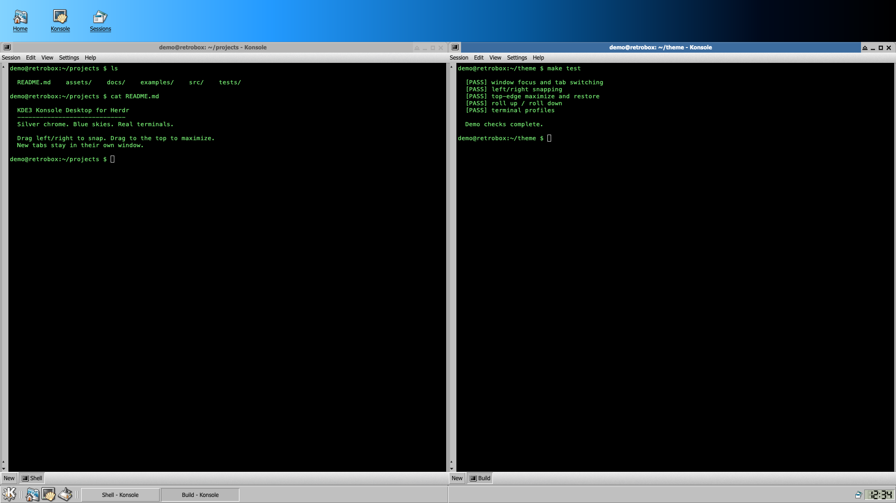

# KDE3 Konsole Desktop for Herdr

A terminal-only Herdr theme inspired by early KDE/Knoppix, with Moheli window
decorations, HighColor artwork, silver controls, a blue desktop and LCD clock.
This is a theme, **not** KDE, Xfce, or the Konsole application.



*The screenshot uses a demo username/hostname and invented filenames, not a real
home directory or terminal history.*

## Features

- Independent terminal windows, with multiple tabs inside each window.
- Active/inactive Moheli decorations and shade, minimize, maximize, close controls.
- Left/right half-screen snapping; top-edge maximize, with preview and restore.
- Taskbar switching, Show Desktop, live command titles and confirmation before closing.
- KDE picture, black, Linux green and paper terminal profiles.
- No virtual-desktop pager: Herdr spaces are work groupings, not KDE desktops.

## Install

Requires Herdr (tested with app 0.1.15/core 0.1.20) and Python 3. No Python or
JavaScript packages need installing.

```sh
git clone https://github.com/yud1z/herdr-kde3.git
cd herdr-kde3
python3 install.py --dry-run
python3 install.py
herdr-app do layout.switch '{"name":"kde3"}'
```

The installer copies **only** this mod, layout/preview, four color profiles, and
the `layout:kde3` keyboard section into `~/.config/herdr-app/`. Existing files that
change are backed up under `backups/kde3-<timestamp>/` there. Other keybinding
sections, layouts, sessions, settings and runtime state are not overwritten.
Use `--dest PATH` for a different Herdr home. Installation makes no network calls.

## Controls

| Action | Control |
|---|---|
| New window | Desktop Konsole / Cmd+Shift+N |
| New tab in current window | Bottom New / Cmd+T |
| Close current tab (confirmation) | Cmd+W |
| Minimize / maximize | Cmd+M / Cmd+Shift+M |
| Show Desktop | Panel desktop icon / Cmd+Shift+H |
| K menu | Alt+F1 |
| Snap left/right | Drag title to an edge; or View menu |
| Maximize from drag | Drag title to top edge |
| Restore after snapping | Drag away; or View → Restore Window Size |
| Roll up/down | Triangle next to minimize |

Bindings supplied here use macOS modifier names; customize `keys.json` for your
platform. Left-rail buttons scroll the actual terminal. Settings switches color
profiles. The default exported profile is Linux green on black.

## Customize and verify

Edit `mods/kde3/ui.js` for chrome, `main.js` for controls, `windows*.mjs` for window
behavior, `themes/kde3*.json` for colors, or `layouts/kde3.json` for fonts.
Herdr hot-reloads installed files.

```sh
node --test mods/kde3/tests/*.test.mjs
python3 -m unittest discover -s tests
python3 scripts/check-publication.py
herdr-app check ~/.config/herdr-app/mods/kde3
herdr-app status
```

## Limitations

These are independent windows **inside Herdr**, not separate OS windows.
Existing arbitrary nested split geometry is rendered as a row/column because
Herdr does not expose the full split tree to mods. Original core tabs and splits
remain intact. See [known limitations](docs/known-limitations.md), including the
native terminal redraw when replacing overlay windows.

## Privacy and artwork

This repository is a fresh, allowlisted theme export, not a copy of a personal
Herdr configuration or its history. Runtime state, credentials, terminal captures,
session identifiers, personal settings and private diagnostics are excluded.
See [SECURITY.md](SECURITY.md).

KDE/Xfce artwork retains its original attribution and license files; see
[ASSETS.md](mods/kde3/ASSETS.md), [COPYING-KDE-ASSETS](mods/kde3/COPYING-KDE-ASSETS)
and [Moheli provenance](mods/kde3/icons/moheli/README.md). The GPL notices apply
to the identified third-party artwork; this export does not replace those terms
or add a separate blanket license grant for the original theme code.
