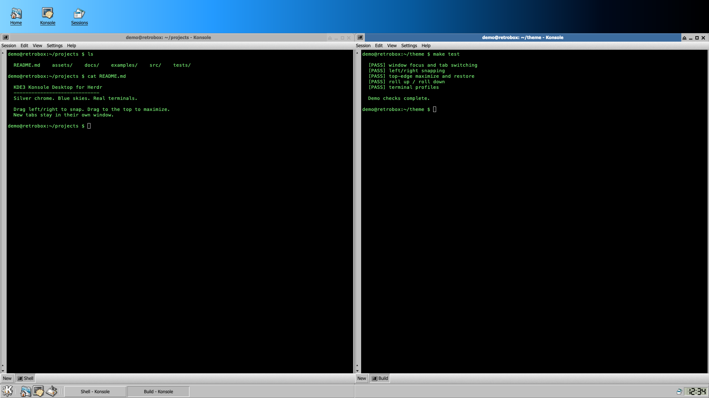

# KDE3 Konsole Desktop

Build a terminal-only desktop inside Herdr that recalls early KDE/Knoppix: a
blue-to-black wallpaper, small illustrated launchers, independent silver Konsole
windows with Moheli decorations, and a bottom Kicker panel. Windows contain real
shells and tabs; they can shade, minimize, maximize and snap. This is a Herdr
layout, not KDE, Xfce or the actual Konsole application. The screenshot shows
synthetic demo sessions, never a real user's name, host or files.



## What you see

- **Desktop:** a full-window horizontal gradient from sky blue through dark blue
  to black: #83d3ff, #239aff at 30%, #075a9e at 58%, #00091b at 85%, #000000.
  Home, Konsole and Sessions sit at the top left, with original 32 px HighColor
  icons and underlined 12 px labels. Each launcher occupies 68×57 px; use 10 px
  outer padding and 18 px gaps. There is no browser, file manager or desktop pager.
- **Windows:** each has a full-width 23 px Moheli title, a 22 px silver menu bar,
  a real terminal with a 14 px left scroll rail, a 27 px New/tab strip, 4 px side
  edges and a 4 px bottom edge. The optional 29 px toolbar is off initially; no
  status bar appears in the independent windows. A lower-right grip resizes them.
  Start windows at up to 860×560 px, bounded to 65% of the viewport dimensions,
  cascading by 60 px horizontally and 48 px vertically from an initial 90,85.
- **Chrome:** #c0c0c0 faces, white raised edges, #808080 shadows, #404040 dark
  edges and #111111 text. Active Moheli captions are #3c6c9f with white bold text;
  inactive captions are #b6b6b6 with #555555 text. The left window-menu icon and
  right shade/minimize/maximize/close group span the same title width as the body.
  Controls are 17×17 px. Use Tahoma, 12 px with a 15 px line height; titles are bold.
- **Terminal:** the exported default is Menlo 13 px with 3 px padding and green
  #70e26d on #000000. Alternatives are #e6e6e6 on #101010, #111111 on #fffef1,
  and white on a blue KDE-wordmark terminal picture. The picture profile reveals
  its image; solid profiles are opaque. Let installed fonts fall back naturally.
- **Kicker:** 36 px high, full width at the bottom. Left to right: K/gear menu,
  grip, Home, Konsole, Show Desktop, grip, horizontally scrolling window tasks,
  stacked Sessions/Settings buttons, then a 69×32 px LCD-clock/date tile. Tasks
  are 168×29 px; the active label is bold and its button sunken. Use a segmented
  24-hour clock and a small day/month/year date. No four-desktop switcher.

## How it behaves

- Konsole launchers create an independent window. Bottom New creates a tab inside
  its own window, not another window. Home opens a local shell in the home folder,
  not a file manager. Sessions lists existing terminal windows; other app-only
  tabs remain untouched. Closing a group's first tab must not orphan its other tabs.
- Clicking a tab selects only that window's terminal. A taskbar click raises and
  focuses its window; clicking the active task minimizes it. Show Desktop hides
  all windows or restores them when all are hidden. Minimizing/shading keeps
  shells alive. Terminal titles follow the selected pane's live title and actual
  foreground process; retain an explicit custom session name as a prefix.
- A blue caption identifies the active window. Other windows are gray; all turn
  gray when Herdr loses platform focus or a confirmation/About dialog is open.
  Buttons have hover, pressed and toggled states; hover tooltips name the action.
- Drag title or unused tab-strip space for an outline move; use the bottom-right
  grip for resize. Only commit geometry on release. A 16 px edge zone previews
  left/right half-screen tiling; the top edge, including corners, previews
  maximize. Leave the edge to cancel that snap preview. A click moving less than
  4 px must not resize or unsnap anything. Dragging away restores the saved normal
  size under the pointer. Resizing and shaded drags do not snap.
- Maximize fills the usable area above Kicker with a 2 px outer margin. Double
  title-click or the maximize button toggles it. Top-edge snapping always
  maximizes, never toggles. Preserve the prior half-snap mode for button restore.
  The triangle immediately left of minimize rolls a window to a 27 px strip;
  it can move down to Kicker. Rolling down shifts it upward if its body would
  otherwise leave the screen. Snapped halves adapt to viewport size changes.
- Close Session asks before ending the selected tab. Title-bar close asks before
  ending every session in that window. Cancel leaves all shells alive; other
  windows are never included. Settings changes among the four terminal profiles.
  Session/Edit/View/Settings/Help cover naming, copy/paste/find, simple splits,
  pane zoom, optional toolbar, font zoom, snap/restore and About/help/layout choice.
- Menus highlight on hover; Up/Down wrap over actionable rows, skipping separators;
  Enter activates. Native Escape dismisses popups/dialogs. K-menu rows are 23 px
  high, with a 24 px vertical KDE banner. Ordinary menus are 252 px wide; K is
  248 px. Heights are content-based and capped at 560 px with scrolling.
- **Agent states:** working and idle keep the ordinary task label, without a
  spinner; blocked prefixes it with !; done prefixes it with a bullet. For a
  multi-tab group, blocked wins over done, then working, then idle. Display actual
  Herdr reports, not simulated statuses. The preview's sample checks are demo text.
- Supplied layout shortcuts: Cmd+T new tab; Cmd+Shift+N new window; Cmd+W close
  session; Cmd+M minimize; Cmd+Shift+M maximize/restore; Cmd+Shift+H Show Desktop;
  Alt+F1 K menu. Do not capture ordinary shell control keys. These modifier names
  assume macOS; adapt bindings for another platform without changing shell input.

## Built from

Create this one-folder package:

```text
RECIPE.md                     reconstruction brief
preview.png                   privacy-safe publication screenshot
layouts/kde3.json              desktop composition and root look
layouts/kde3.svg               installed settings preview, not runtime data
mods/kde3/{main.js,mod.json}    one native GPUI mod, multiple roles
mods/kde3/ui.js                bevels, gradients, artwork, LCD, Moheli controls
mods/kde3/model.mjs            pure dimensions, frame/profile/session/menu rules
mods/kde3/windows-model.mjs    pure window composition, snapping, titles and focus
mods/kde3/windows.mjs          live window groups, lifecycle and scoped actions
mods/kde3/actions.mjs          popup-to-persistent-command dispatch
mods/kde3/{desktop-blue.svg,konsole-blue.svg,icons/}
mods/kde3/tests/               model, controller and actual drag-handler tests
themes/kde3{,-black,-linux,-paper}.json
keys.json                     only the layout:kde3 section
```

The root is a non-resizable column with desktop above a fixed 36 px Kicker block.
Set titlebar to none, hide macOS traffic lights off-canvas, apply the wallpaper,
root font/padding, the Linux-green profile and terminal opacity 1. The supplied
desktop tree retains a hidden legacy scaffold: desk-top (desktop role, 90 px),
desk-row (left spacer, konsole column, right spacer), and desk-bottom spacer.
The konsole column has title/body/edge blocks with the legacy title, menubar,
toolbar, scrollbar, tabs, status and frame roles. Hide that entire column on
initialization; its terminal placeholder is a spacer, never a second terminal.
Kicker uses the panel role. All these blocks use the same kde3 mod; no shipped
mod is embedded or edited. The scaffold is not the visible window implementation.

Open kept, frameless native window overlays. Each shallow layout is a column of
floating-title, floating-menu, optional floating-toolbar, a body row (left edge,
scrollbar, row/column of explicit terminal-address blocks, right edge),
floating-bar and bottom frame. The owning window ID travels in props.tab;
frame uses props.part. Auxiliary roles are menu (items/title/kmenu), drag
(owner/mode/start/frame/restoreFrame/shaded), about and confirm (owned tab or
window/session IDs). Use native GPUI elements, never HTML/CSS or a web view.

Use Herdr's live spaces(), panes(), terminals(), focused(), layout(), layouts()
and window() data. Resolve each explicit terminal to its own group. Store group
tabs, activeTab, normal frame, min/big/shaded/snap state, overlay identity,
revision/signature, snap viewport and pending focus in shared("kde3.windows").
Keep window identity independent of its first core tab. New core tabs attach via
a unique temporary pending marker, then get a normal Shell label. Focus maps
the actual terminal back to its group. Titles prefer raw terminals().title and
foreground.name: the pane's friendly name can misleadingly call htop "Activity".

Actions use tab.new/space.new without argv (the configured shell), tab.rename,
tab.close with confirmation, pane.focus, explicit-pane split/zoom, terminal
copy/paste/search/scroll, app font zoom/settings/help and layout switching.
Opening a tab/window can inherit its terminal folder; Home uses home(). Never
invent model IDs or rewrite another layout's tabs/splits. Runtime makes no
network requests and calls neither exec nor hc. Its only explicit external-folder
file access is readTextFile/writeTextFile of its own layouts/kde3.json, using
appHome() and an expected-content guard for profile changes. Picture opacity is
0; the other profiles use 1. Keep this disclosure when distributing the mod.

Receive key/menu commands through nextCommand() on the persistent first desktop
copy. Popups dispatch untargeted deferred work before closing; synchronous
window actions carry their owner. View instances own tasks/handles; obtain a
fresh callback context, never retain cx. Reconcile overlay lifecycle once per
second; a 30-second clock check only notifies when the displayed minute changes.
Live model changes otherwise rerender automatically. Use native painting for
gradients, not animation timers.

Bundle original KDE 2.2.2 HighColor 16/32 px icons and Xfce Moheli artwork. Obtain
the originals from the source archive paths and upstream commit listed in
ASSETS.md; preserve COPYING files, XPM sources, palette and hash manifests.
Moheli symbolic colors resolve to the blue/gray palette without changing pixel
geometry. Reconstruct the two wallpaper SVGs, LCD digits and banner as local
vectors. No KDE/Xfce binaries or fonts are installed by the package.

Verification commands for the supplied build:

```sh
node --test mods/kde3/tests/*.test.mjs
python3 -m unittest discover -s tests
python3 scripts/check-publication.py
herdr-app check ~/.config/herdr-app/mods/kde3
herdr-app status
```

## Watch out

- Read the destination's generated Herdr declarations. The build was tested on
  app 0.1.15/core 0.1.20. Do not edit shipped mods, AGENTS.md, declarations,
  shared.json or layout .state files. On import, preserve other layouts and keys;
  rename colliding layout/mod names, commands, paths and references consistently.
  Inspect installer changes first: it backs up and replaces this theme's own
  files/keyboard section, rather than resolving name/key conflicts interactively.
  Keep RECIPE.md and the publication preview.png out of the installed app folder.
- Native host arguments have a 16-level nesting limit. Keep window compositions
  shallow; do not send the full deep desktop through layout.set. Guarded file
  updates change only this layout's root theme/opacity. IDs must be unique within
  a composition, including when arranging multiple demonstration windows.
- Same-key native replacement is not retained-content mutation. It is needed to
  raise a covered window; focus alone does not reorder it. Do not explicitly
  close before replacing. For new geometry, use a revised key and retire the old
  overlay only after opening its replacement. Defer focus until after initial
  layout (the build waits 30 ms from the size callback), keyed to the requested
  overlay so stale rapid-switch callbacks cannot steal focus. Do not also select
  the hidden core tab when switching a composition terminal.
- Herdr can still reset the PTY briefly to 120×40 on replacement, making htop
  redraw. This remains a host limitation, not a solved smooth-switch promise.
  Desktop layout.select does not select stacks inside an overlay. The full
  existing split tree is unavailable: show its terminals as a row/column without
  rewriting it. The left rail offers real scroll buttons, not a fake draggable
  thumb; Herdr's own right-side thumb may still appear. No dead pager or fake apps.
- Normal frame bounds target at least 500×280 px where space permits, staying
  above Kicker. Snapped halves bypass that minimum and divide odd widths exactly.
  Shaded movement uses the visible 27 px height, not the hidden expanded body.
  Preserve the normal frame separately from snap/maximize geometry.
- Publish only the theme bundle. Never include runtime state, personal settings,
  diagnostics, terminal history, real session IDs or private screenshots. Render
  any new preview with a generic demo username/host and invented filenames; inspect
  pixels and PNG metadata. Retain third-party artwork attribution and licenses.

## Done when

- The layout opens with three desktop launchers, full-width Moheli window chrome
  and the bottom Kicker/LCD clock. There is no duplicate terminal or desktop pager.
- Two real shell windows stay independent; New adds/selects a tab in its owner.
  Closing the first tab preserves its group, and modal Cancel ends nothing.
- Actual terminal focus matches each selected tab; taskbar raise/minimize/restore
  acts on the chosen window. Focus colors respond to other windows, app activation
  and dialogs. Live titles show a real foreground process rather than its category.
- Left/right drops tile above Kicker, top drops maximize without toggling, drag-away
  restores, and tiny clicks do not resize. Roll-up reaches the bottom; roll-down
  remains visible. Maximize/restore and viewport changes preserve sane geometry.
- All four profiles visibly change terminal colors/opacity after their popup closes.
  Copy/paste/find, scroll controls, simple splits, pane zoom and menu keyboard
  navigation act on real terminals. Existing unrelated tabs and layouts remain intact.
- The supplied theme's 58 regression tests, installer/privacy tests, native mod
  check and error status pass. Native screenshots confirm resulting window geometry;
  production drag handlers are tested directly when physical pointer automation
  is unavailable. Record the known native redraw rather than claiming it gone.
- One public repository folder contains the layout, required mod/art, profiles,
  scoped keys, this recipe and preview.png. The preview is visibly privacy-safe,
  its metadata and exported files pass the publication audit, and the repository
  has the herdr-layout topic. Allow up to an hour for catalog indexing.
